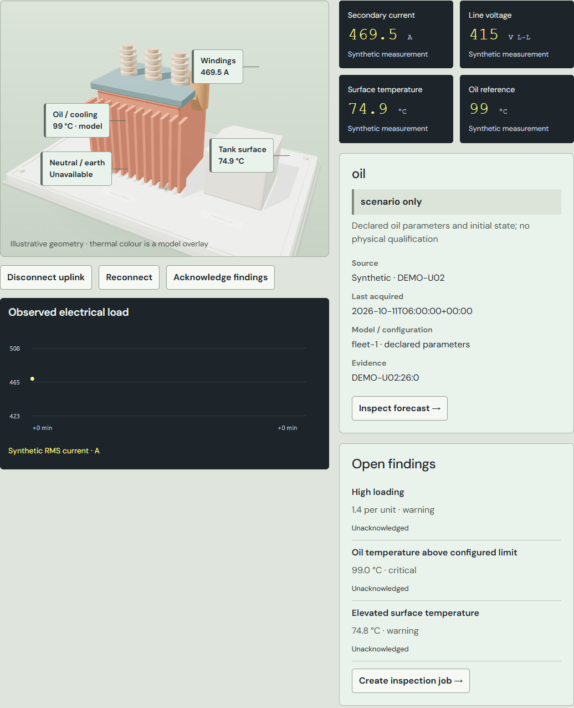
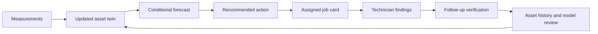
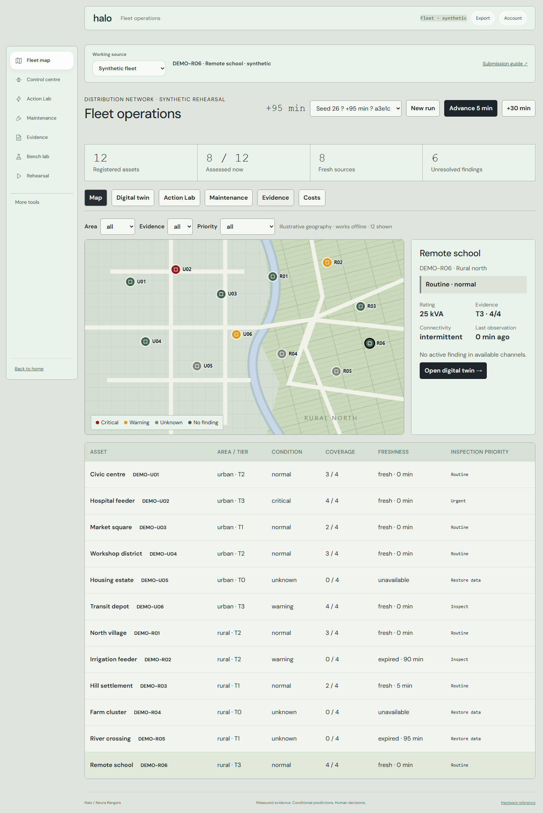
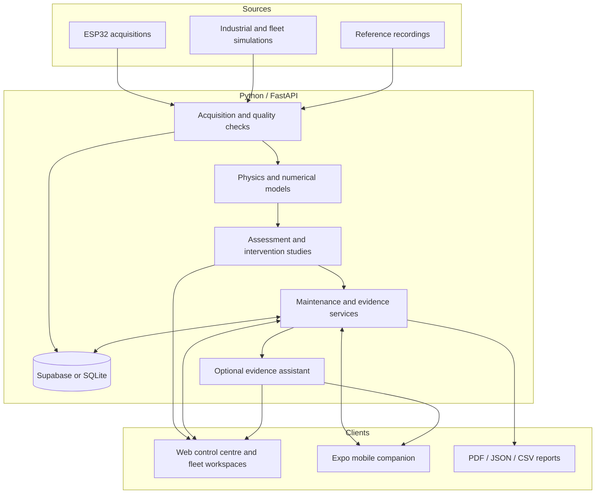

<div align="center">

# NeuraTwin Halo

### Physics-informed digital twins for distribution-transformer maintenance

**From physical measurements to a verified maintenance outcome.**

Neura Rangers · PowerNext AI · Digital Twin Track

[Project presentation](NeuraTwin_Halo_Pitch.pptx) · [Platform](#the-platform) · [Physics](#physics-behind-the-twin) · [Architecture](#system-architecture) · [Run locally](#run-locally)

</div>

---

NeuraTwin Halo helps maintenance teams manage difficult-to-access distribution transformers by combining available measurements, an asset-specific predictive model and maintenance history to prioritise inspections and verify corrective actions.

The platform connects an **ESP32 physical prototype**, an **interactive 3D twin**, **thermal and electrical studies**, **urban/rural fleet operations**, and **traceable maintenance records**. Every assessment stays attached to its asset, source readings, model assumptions and observation time.

The central question is practical: **which transformer needs attention, what action is justified, and did that action improve its condition?**

<p align="center">

</p>
<p align="center"><em>Interactive asset inspection with component evidence and source-labelled instruments. Screenshot shows a synthetic fleet asset.</em></p>

## The problem

A high temperature reading is only the beginning of a maintenance decision. An operator must understand the loading, assess the available evidence, decide whether to inspect or reduce load, and verify what happened after the intervention. Rural installations add intermittent connectivity and difficult physical access. Extensive instrumentation adds hardware, installation and service costs.

Halo brings these concerns into one workflow:



An inspection retains the condition that justified it. A prediction remains available for comparison with later observations. A maintenance outcome records its supporting evidence, including an inconclusive result when improvement cannot be established.

## The platform

| Workspace | What it provides | Why it matters |
| --- | --- | --- |
| **Fleet map** | Urban/rural assets, condition markers, sensing coverage, data freshness and inspection priority | Locate assets that need attention and distinguish equipment concerns from missing information |
| **Fleet decisions** | Recording-based triage, qualified thermal models, report cards and constrained load-transfer studies | Compare asset needs using inspectable evidence |
| **Control centre** | Large instruments, live trends, configurable temperature alarms and source-specific 3D models | Understand the selected transformer's operating condition |
| **Action Lab** | Frozen forecasts, load-reduction comparisons and later scoring | Examine possible interventions before acting |
| **Physics and protection** | Thermal response, oil inventory, pressure, electrical stress and finite-element studies | Explain how operating conditions affect the modelled transformer |
| **Maintenance** | Assigned jobs, technician findings, photos, action records and reviewed follow-up | Carry an issue through to a documented outcome |
| **Evidence and reports** | Recorded history, forecast comparisons, PDF reports and structured exports | Preserve the basis of an assessment and decision |
| **Mobile companion** | Expo app with twin, alerts, inspections and an evidence-aware assistant | Bring asset information and field observations to a phone |

### Fleet map: urban and rural operations

<p align="center">

</p>

The interactive map connects **six urban and six rural synthetic transformers** through one reproducible simulation clock. Selecting a marker or row carries the asset into its digital twin, forecasts, maintenance jobs, evidence and costs.

Assets differ in rating, sensing coverage and communication pattern. **Condition, evidence coverage, freshness and inspection priority** remain separate: an asset with no usable observations is unknown, while a communication outage does not erase an unresolved finding.

Rural scenarios include intermittent, scheduled and visit-only communication. When the uplink disappears, observations age and forecasts expire at a configured validity boundary. Recovered records retain their original acquisition time; importing an old buffer adds historical evidence without making the asset appear live.

The current map is a bundled geographic schematic with illustrative locations. It works without external map tiles and does not represent a connected utility GIS inventory.

### Fleet decisions: a model report card for every recording

The separate Fleet decisions workspace supports a **25-asset synthetic portfolio** and imported oil-temperature recordings. Its attention queue combines observed limits, missing or stale evidence, model disagreement and asset criticality. The reasons contributing to priority remain visible.

Each asset's thermal model is fitted and evaluated using chronological **60% fit / 20% calibration / 20% test** partitions. Report cards expose error against persistence, error tails, empirical forecast-band coverage and qualification holds. A model is withheld when it fails the declared screening policy or current inputs leave its fitted operating range.

A load-transfer study checks declared ties, simultaneous observations, qualified thermal evidence, voltage, loading limits and equal-kVA balance. It supports planning; it does not establish network load-flow feasibility or authorise switching.

Laboratory gas reports can be recorded separately, with combustible totals and per-day trends. These remain entered laboratory evidence, never ESP32 gas measurements. Portfolio cases retain the triage reasons and model report for review in Maintenance.

The 25-asset recording portfolio and the 12-asset map are distinct workspaces; their recordings are not silently substituted for live equipment. [Read the fleet methods](docs/FLEET_EVIDENCE.md).

### Control centre and interactive digital twin

The control centre combines seven-segment-style readings, high-contrast trend plots, visual annunciators, audible alarms and an interactive 3D transformer. Prototype and industrial sources use appropriate models.

Operators can inspect primary/secondary voltage, available current channels, loading, surface temperature and clearly identified estimates. Configurable surface-temperature thresholds connect actual probe readings to the alert system. Browser audio starts after the interaction required by the browser's playback policy.

Floating component annotations connect the visual model to electrical, surface and oil evidence. Thermal colour overlays make the modelled state spatially visible. Electrical scopes reconstruct illustrative waveforms from RMS values; they are not oscilloscope captures. The physical bench is single-phase, while industrial scenarios also support three-phase studies.

### Action Lab: forecast, intervene, compare

Halo compares continued operation with candidate load reductions under declared thermal and loading assumptions. The study retains the predicted response, constraints and proposed action so the operator can inspect the reasoning.

Forecasts are **frozen before later observations are scored**. They retain the input cutoff, source and model version. Changed loading, missing references and incompatible configurations remain visible as exclusions. Persistence—the last observed value—is retained as a baseline.

In the fleet map, assets with a separate synthetic oil-reference channel support target-matched scoring. A model-only oil estimate cannot validate itself.

### Maintenance with recorded follow-up

Job cards connect a concern to readings, forecasts, acceptance criteria and the selected asset. They support assignment, acceptance, inspection notes, photographs, recorded actions and reviewer decisions.

Follow-up compares later compatible observations with the recorded criteria. Depending on the workflow, outcomes distinguish improvement or mitigation, temporary stabilization, unresolved conditions and insufficient evidence. Completing a review or acknowledging an alarm does not certify that equipment has recovered.

For fleet field work, assigned jobs and visit drafts can be retained in an IndexedDB outbox that survives tab closure. Synchronization rechecks identity, assignment and record revisions. Conflicts retain the draft for explicit review. Unsynchronized drafts are local to that browser and are removed by clearing browser storage or signing out.

### Reports and asset identity

PDF reports bring readings, charts, assumptions, events and maintenance evidence into a readable asset record. JSON and CSV exports support further analysis; checksum manifests allow content to be checked against retained records.

Asset passports provide registered links and QR identification, with NFC writing on supported browsers. They identify the asset; permissions remain enforced independently.

## Physics behind the twin

Halo combines loading-guide-style thermal models, electrical screening and numerical thermal-field studies. Equations, assumptions and source provenance remain inspectable.

### Loading and temperature response

For observed current $I$ and rated current $I_r$:

$$K = \frac{I}{I_r}$$

The virtual top-oil study approaches a load-dependent target:

$$\theta_{\mathrm{target}} = \theta_a + \frac{\Delta\theta_r}{c}\left(\frac{1+RK^2}{1+R}\right)^{0.8}$$

$$\theta_{t+\Delta t} = \theta_{\mathrm{target}} + (\theta_t-\theta_{\mathrm{target}})e^{-\Delta t/\tau}$$

Here $\theta_a$ is ambient temperature, $\Delta\theta_r$ is rated rise, $R$ is the load-loss/no-load-loss ratio, $c$ is the cooling factor and $\tau$ is the thermal time constant. Electrical response is immediate; heating and cooling evolve over time.

The DS18B20 measures **surface temperature**. It can initialise a virtual oil scenario, but the oil result remains a model output. Accelerated model time is explicit. The implementation is loading-guide-inspired, not a complete IEC compliance calculation or an experimentally identified industrial model.

### Oil inventory and thermal expansion

Material inventory and temperature-dependent expansion are represented separately:

$$V_{\mathrm{inventory}} = V_0 - V_{\mathrm{lost}} + V_{\mathrm{refilled}}$$

$$\Delta V_{\mathrm{expansion}} = \beta V_0(\theta_{\mathrm{bulk}}-\theta_0)$$

The inventory study supports **200 L initial oil**, slow or rapid loss, simulated refill, warning/critical thresholds and time to a configured limit. A decline to 170 L represents 30 L lost and 85% remaining. Expansion does not replenish that lost material.

Declared oil density and specific heat connect the remaining quantity to thermal capacity. Leakage and gas accumulation are injected scenarios rather than measurements from the physical bench.

### Sealed-tank pressure

A rigid sealed-tank scenario combines oil expansion with a fixed gas cushion:

$$P_{\mathrm{abs}} = P_0\frac{T}{T_0}\frac{V_{g0}}{V_{g0}-\Delta V_{\mathrm{expansion}}+V_{\mathrm{lost}}}$$

Temperatures are absolute, and gauge pressure is reported relative to the assumed atmospheric reference. A vented conservator uses a different model and does not inherit this sealed-tank output.

This exposes pressure sensitivity without adding a pressure transducer to the bench. **Actual internal pressure cannot be identified from voltage and current alone.** The calculation depends on declared fill, gas volume and tank behaviour; it is a conditional study rather than a replacement for a pressure sensor or protective relay.

### Electrical stress and protection studies

Electrical screening combines per-unit current, duration, voltage dip and a startup guard. Current-time exposure is retained as:

$$I^2t = \int I(t)^2\,dt$$

For the idealised transformer-only impedance case, prospective symmetrical RMS fault current follows:

$$I_{\mathrm{sc}} \approx I_r\frac{100}{Z_{\%}}$$

Industrial studies also support declared source/cable impedance on a common base. Entered winding resistance enables an explicit $I^2R$ loss calculation.

Exceeding the prototype's 1 A rating indicates overload relative to that reference; it does not alone prove a short circuit. Inrush and internal/external fault discrimination require suitable independent waveform evidence. The separate synthetic electrical challenge exercises those distinctions without presenting generated waveforms as physical acquisitions.

### Finite-element thermal modelling

The thermal-field study solves conduction with internal generation and convective boundaries:

$$\rho c_p\frac{\partial T}{\partial t}-\nabla\cdot(k\nabla T)=q$$

Steady and transient studies use **648 triangular elements and 361 nodes** on a declared cross-section. The transient solver uses backward Euler integration and sparse solves. Mesh refinement, time-step refinement and heat-balance checks expose numerical consistency.

The visual field extrudes the solved two-dimensional temperatures through a declared depth. It is not a full 3D CFD solution. Geometry, material properties and losses remain study assumptions.

A sensor-placement experiment compares one, two and three accessible measurement locations on held-out synthetic loss cases. It connects spatial physics to the practical question of where additional sensing could provide useful information.

### Health, limits and lifetime scenarios

| Output | Meaning |
| --- | --- |
| **Condition index** | Inspectable screening score with contributing stress factors and data-quality holds |
| **Time to configured limit** | Conditional temperature projection under stated future loading and ambient assumptions |
| **Modelled remaining life** | Scenario output based on assumed prior exposure, thermal ageing and survival parameters |
| **Simulated failure risk** | Thermal-ageing scenario probability, not calibrated all-cause field failure probability |

Lifetime scenarios explore sensitivity to temperature, loading and assumed age. Current evidence does not establish an individual transformer's actual remaining useful life.

Methods: [thermal and pressure models](docs/PHYSICS_AND_PROTECTION.md) · [transient FEM and maintenance verification](docs/MAINTENANCE_WORKFLOW.md) · [life and risk](docs/LIFETIME_SCENARIOS.md).

## Lower-cost sensing and reliability

Halo's sensing strategy is to use available measurements productively and identify where another measurement could change a decision. The synthetic map represents four instrumentation tiers:

| Tier | Available channels | Supported evidence |
| --- | --- | --- |
| **T0 — registered asset** | No current telemetry | Asset identity/history and an explicit need to collect evidence |
| **T1 — electrical** | Voltage and current | Loading and electrical context |
| **T2 — electrical + surface** | Voltage, current and surface temperature | Surface condition alongside conditional thermal studies |
| **T3 — reference sensing** | Electrical, surface and separate oil reference | Target-matched oil-forecast scoring within the synthetic experiment |

Cost workspaces compare instrumentation options using entered hardware, installation, commissioning, service and connectivity costs over a declared population and period. Unknown costs remain unknown. Maintenance studies also examine how resolving a model uncertainty could change an intervention.

The intended reliability benefit comes from earlier attention, better-targeted inspections and verified follow-up. Deployed savings and reduced field failure rates remain outcomes for prospective validation, rather than claimed results of simulation.

## Physical prototype and source integrity

The physical demonstrator uses a **12-0-12 V, 1 A centre-tapped transformer**, **ESP32**, voltage/current sensing, a **DS18B20 surface probe**, and resistor loads controlled through a four-channel relay module. The current Wi-Fi mapping exposes three active branches; the fourth UI command requests all three off.

The backend polls authenticated acquisitions over Wi-Fi. Automatic reconnection checks the configured address, mDNS and bounded local-network discovery after a restart or address change. Device identity, acquisition time and freshness remain attached to readings.

| Source | Interpretation |
| --- | --- |
| **Physical prototype** | Received electrical/surface acquisitions, quality information and separately labelled calculations |
| **Industrial simulation** | Persistent modelled transformer with its own clock, conditions and events |
| **Synthetic fleet** | Reproducible assets with different sensing and connectivity profiles |
| **Portfolio/reference recordings** | Separately identified historical data and experiments with their own provenance |

Measured current and load-bank estimates remain separate. Firmware-calculated primary current is not promoted to a direct measurement. A valid measured zero stays zero; missing or stale measurements do not become fresh observations. The bench does not directly measure oil temperature, winding hot-spot or tank pressure.

Physical switching remains an explicit authorised operation. Fault scenarios and the language assistant do not send equipment commands. The small prototype demonstrates acquisition and workflow; its thermal parameters do not automatically transfer to a distribution transformer.

[ESP32 integration](docs/ESP32_INTEGRATION.md) · [Measured versus estimated readings](docs/MEASURED_AND_ESTIMATED_READINGS.md)

## System architecture



| Layer | Implementation |
| --- | --- |
| Web | HTML, CSS, JavaScript, Three.js and SVG/canvas instruments |
| Numerical backend | Python, FastAPI, NumPy, SciPy, pandas and scikit-learn |
| Storage and access | Supabase with team authentication, or explicitly selected local SQLite |
| Field continuity | Service-worker shell and IndexedDB fleet visit outbox |
| Hardware | Authenticated ESP32 Wi-Fi API, mDNS rediscovery and a separate USB bridge option |
| Mobile | Expo / React Native with twin, alerts, inspections and assistant views |
| Reporting | ReportLab PDFs, structured exports and SHA-256 manifests |

The numerical application works independently of the optional language assistant. The assistant explains available evidence and cannot operate equipment. Credentials remain on the backend.

The mobile companion opens its interface even when the ESP32 or backend is unavailable, marks cached/unavailable readings, and retains inspection drafts for reconnection. Native notifications require a configured device build and delivery credentials. [Mobile project](mobile/README.md).

## Evaluation and evidence

Halo distinguishes **software correctness**, **numerical consistency**, **synthetic performance** and **physical validation**.

| Area | Verification focus |
| --- | --- |
| Source integrity | Measured/estimated separation, freshness, configuration changes and board restarts |
| Thermal calculations | Load response, cooling, equilibrium, heat balance and refinement sensitivity |
| Forecasting | Frozen inputs, chronological scoring, target matching, baseline comparisons and exclusions |
| Fleet operations | Shared clocks, revision checks, expired data and historical import deduplication |
| Maintenance | Assignment permissions, retained drafts, later observations and inconclusive outcomes |
| Interface and reporting | Navigation, narrow layouts, source switching, exports and unintended-command prevention |

The latest merged verification record reports **566 backend tests and 101 JavaScript tests passing**, alongside browser checks for fleet records, maintenance, transfer studies, costs and PDF export. These are recorded software checks, not a claim of physical validation. See [verification details](docs/FLEET_EVIDENCE.md#verification).

A separate chronological experiment uses the public **ETTh1** dataset. Validation selected gradient boosting, but its later test performance did not outperform persistence. All candidate comparisons are retained. Results use the dataset's source units rather than claiming verified degrees Celsius.

Synthetic cases support reproducible behaviour, and numerical checks establish properties of the implemented solver. Industrial prediction accuracy, calibrated failure probabilities and maintenance outcomes require independent field evidence.

[Public-data forecasting](docs/EXTERNAL_ETT_FORECAST.md) · [Evaluation protocol](docs/EVALUATION_PROTOCOL_AND_EXTERNAL_RECORDINGS.md) · [Hardware provenance](docs/HARDWARE_PROVENANCE_AND_RECOVERY.md) · [Tests](tests/)

## Run locally

Use Python 3.12 or later. From the repository root:

```powershell
python -m venv .venv
.\.venv\Scripts\Activate.ps1
python -m pip install -r requirements.txt
python scripts/run_local_demo.py
```

Open [Fleet map](http://127.0.0.1:8765/app#fleet), [Fleet decisions](http://127.0.0.1:8765/app#portfolio), or [Control centre](http://127.0.0.1:8765/app#control). The standalone launcher uses SQLite and disables physical control and the optional AI service. An ESP32 is not required to explore simulated assets.

For a configured backend with private environment settings:

```powershell
python -m uvicorn neuratwin.app:app --host 127.0.0.1 --port 8765 --env-file .env
```

[`.env.example`](.env.example) documents configuration. [Backend operations](docs/BACKEND.md) covers Supabase, team roles and hosting. The full platform needs the Python backend; static hosting alone does not run its models or persistence services.

Automated checks:

```powershell
python -m pip install -r requirements-dev.txt
python -m pytest tests -q
node --test tests/*.mjs
```

## Repository guide

| Path | Contents |
| --- | --- |
| [`neuratwin/`](neuratwin/) | APIs, acquisition, physics, forecasting, fleet and maintenance services |
| [`web/`](web/) | Web application, 3D models, instruments, plots and offline shell |
| [`mobile/`](mobile/) | Expo mobile companion |
| [`firmware/esp32_integration/`](firmware/esp32_integration/) | ESP32 acquisition and load-control integration |
| [`supabase/migrations/`](supabase/migrations/) | Storage and access migrations |
| [`tests/`](tests/) | Python and JavaScript verification |
| [`reports/`](reports/) | Retained evaluation outputs |
| [`docs/`](docs/) | Model methods, evidence rules and operations |
| [`NeuraTwin_Halo_Pitch.pptx`](NeuraTwin_Halo_Pitch.pptx) | Project presentation |

---

<div align="center">

**NeuraTwin Halo · Neura Rangers**

Measured evidence. Conditional predictions. Human decisions.

</div>
