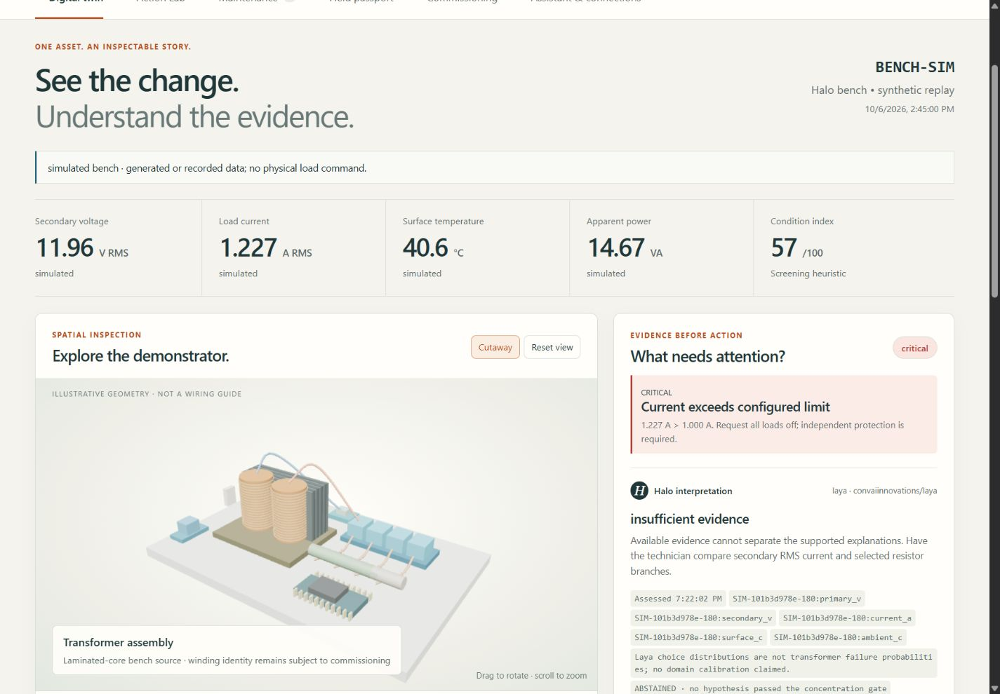

# NeuraTwin Halo

Digital-twin demonstration for **CPRI Track 2**, by **Neura Rangers**. This repository contains the current application, ESP32 firmware, integration scripts, hardware documentation and recorded validation. Historical screening submissions and private runtime data are not included.



The current workspace is **http://127.0.0.1:8765/app**. It reconciles the 1 October project plan with the actual four-relay, 39 Ω load-bank build. The original distribution-transformer model remains available as a separate study; physical surface temperature is never relabelled as transformer oil or winding hot-spot.

## Start the demonstration

From this folder in PowerShell:

```powershell
.\start-halo.ps1
```

This starts the application and, if installed, the isolated local Laya server. It **does not** open a serial port, send Telegram messages, energise relays, or clear commissioning holds. Use `-WithoutLaya` for the deterministic fallback. Stop the application with Ctrl+C. Laya is a separate background process on loopback port 8766; close that specific process when no longer needed.

On a new machine, use Python 3.12 or newer and install the application dependencies:

```powershell
python -m pip install -r requirements.txt
```

For Laya, install [uv](https://docs.astral.sh/uv/getting-started/installation/) if needed, then:

```powershell
uv venv --python 3.12 .venv-laya
uv pip install --python .venv-laya/Scripts/python.exe -r requirements-laya.txt --torch-backend cpu
```

The first Laya launch downloads the English model; allow several minutes. Subsequent inference uses cached weights locally. The launcher pins checkpoint `7b928d828b7b0e022f929d9bd2e44165aa270148` for reproducibility. The application remains usable if the model is absent. The model service is bound to **127.0.0.1:8766**, never publicly exposed by these scripts.

## A coherent five-minute demo

1. Open **Bench replay / simulation** and inspect the 3D components and the explicit measurement sources. Rotate / cut away the illustrative assembly. It is not a wiring drawing.
2. Open **Action Lab** on a normal synthetic run. Advance the replay to frame 360, qualify that synthetic healthy period, give a calibration note, and fit the surface model. Inspect the held-out error against persistence. Only an improving model activates; keep the synthetic qualification explicit.
3. Return to the twin and select **Overload · simulated only**. Current crosses the configured demonstration limit; K4 is visibly simulated. Interpret the evidence with local Laya. Numerical warnings persist even if the model abstains or fails.
4. Compare two futures from the same starting state. Review extrapolation and horizon warnings. The envelope search may return no qualifying candidate; it does not authorise equipment operation.
5. Open a maintenance incident. Acknowledge, inspect, record an action and follow-up evidence. A replay cannot prove an actual repair; resolution requires comparable calibrated physical evidence.
6. Show the field passport, real QR URL, NFC capability fallback, Telegram command preview and typed assistant. A judge can choose a hidden synthetic case at **/judge**; assess before revealing the case.
7. Select **Physical bench · USB**. Until connected, it reports disconnected / unavailable rather than substituting simulated readings.

For a forecast immediately without fitting a bench model, use **Distribution transformer study**. Its existing model has synthetic calibration and explicitly unvalidated winding estimates. A useful demonstration is Evening overload at frame **148**, a **60-minute** horizon and **25% reduction** with zero delay: the conditional central peaks are approximately **131.2 °C** versus **109.5 °C**. These are model outputs under constant input assumptions, not measured temperatures or a demonstrated field benefit.

## Implemented scope

### Evidence Lab · October 2026 upgrade

Open **07 Evidence Lab** at `/app#evidence`. Its six tools share the selected asset, source and replay frame:

| Tool | What is implemented |
| --- | --- |
| Investigate | Frozen expected/observed temperature response, persistent residual screening, competing explanations and the next reference check; no invented fault probabilities |
| Plan an action | Discrete removal-only K1–K3 options on the bench, protected branches, compulsory K4 removal in simulated candidates; distribution demand-reduction search, delay, rejected constraints and sensitivity-envelope limits |
| Prove a forecast | Timestamped predictions with copied model/inputs and SHA-256, later observations scored without rewriting predictions, persistence baseline, changed-input and missing-data accounting; up to five chronological benchmark origins |
| Acceptance checks | The 12 supplied CPRI examples, absolute measurement errors, explicit zero-reference handling, reviewer-entered tests, separate software acknowledgment and independently observed contact timing |
| Condition & ageing | Separate operating-stress index and evidence coverage; explicit hypothetical Arrhenius scenarios for the distribution study. Bench surface readings never produce oil-paper ageing or actual RUL |
| Lab evidence | Reviewed DGA, 2-FAL, moisture, breakdown-voltage and acidity entries; fixed units, provenance, laboratory flags and separate real/fixture trends; JSON templates and imports |

**Download case** produces a ZIP containing `report.html` (printable to PDF), `case.json` and `manifest.json`. Reports retain assumptions and the maintenance trail. File hashes detect changes against the manifest; they are not signatures or verification of measurement truth. Evidence records are local SQLite data; they are not included in Git.

Calibration now records voltage, current, surface and ambient references independently. An electrical calibration does not verify the temperature probe. Physical modelling needs verified ambient-probe evidence or an explicit independent ambient observation. Imported model fitting stops at the selected replay frame; it cannot consume later frames. Older model versions without fitting timestamps must be refitted before freezing predictions.

**Repeatable Evidence Lab demonstration:**

1. Choose **Distribution transformer study / Evening overload**, open Evidence Lab, enter frame **148** and choose **Go to frame**.
2. Review the investigation. In **Plan an action**, enter a **60-minute** horizon and **3-minute** maximum delay. The current synthetic fixture returns a **30% reduction**, conditional on the declared model and constraints. Expand the rejected candidates.
3. In **Prove a forecast**, freeze **15 minutes**. Score immediately: it awaits future observations. Move to frame **151** and score the same record. This reveals three later simulated oil readings; it does not establish field accuracy. Run the rolling benchmark separately.
4. Load the supplied examples in **Acceptance checks**. Demonstrate a deliberately failing fixture: 12 V reference versus 11.5 V software reading, 1% tolerance. Select **Demonstration fixture**, and label the instrument and notes accordingly.
5. Inspect **Condition & ageing** and **Lab evidence**. Any demonstration laboratory values must be explicitly marked as fixtures. Actual remaining life stays unavailable.
6. Download the case. Open the HTML report and use its print/save-PDF button.

For a bench forecast: qualify the **normal synthetic** run at frame **360** in Action Lab, fit a new model, then freeze at frame **400**. The built-in bench replay now reaches frame **720**, allowing subsequent observations to be revealed without changing the source. A discrete bench planner may return no qualifying candidate when current or ambient leave the training range or the horizon exceeds validation; this is intentional.

**Validation:** 65 automated tests passed for this revision, including per-channel calibration, future-frame exclusion, frozen-record integrity, changed inputs, missing observations, conservative load planning, response-timing semantics, unit validation and export escaping. See `reports/halo-evidence-tests.xml` and `reports/halo-evidence-validation.json`. Browser checks cover desktop and phone widths, planning, freeze/reveal/score, acceptance, reviewed lab fixtures, ageing and export. Hardware commissioning has not been performed by these software tests.

### Existing connected workspace

| Area | Current behaviour |
| --- | --- |
| Physical / replay / distribution data | Separate sources, units, clocks, asset identities and evidence references |
| 3D workspace | Local procedural bench and distribution models, component selection, cutaway, paired forecast views, accessible evidence fallback |
| Monitoring | Freshness, coverage, calibration, current and surface limits, rise-rate and load-bank discrepancy checks; unavailable values remain null |
| Health | Explicit screening heuristic, separate from model confidence; no invented RUL or failure probability |
| Action Lab | Same-state conditional futures; reviewed bench model, chronological 70/30 validation, persistence baseline, version activation / rollback, 5% envelope search |
| Laya | Local typed hypothesis and inspection choices, distributions, evidence references, prompt version, latency, abstention and deterministic fallback |
| Maintenance | Persisted incident → acknowledgment → inspection → action → follow-up → evidence verification; photos retained as evidence without invented vision diagnosis |
| Field tools | QR, capability-detected Web NFC, cached application shell and clearly historical offline snapshot; local observation drafts |
| Assistant | Typed questions, optional browser speech recognition / synthesis, local avatar, allowlisted view and highlight actions; no conversational switching |
| Telegram | Opt-in worker, allowed chats, status / questions / acknowledgment / observations / photos; explicit subscription to changing physical-bench warnings |
| USB | Authenticated bridge, monotonic sequence / boot identity, host-anchored acquisition time, durable retry outbox, quarantine of rejected historical frames |
| Firmware | ADC waveform RMS after DC-bias removal, DS18B20 surface reading, declared pins, local command gates, heartbeat timeout and K4 rejection |

AR, additional vibration/oil sensors, grid transfer optimisation, calibrated failure probabilities, oil/winding measurements on the bench and validated remaining life are **not implemented or claimed**. There is no installed ambient probe; an actual independently observed room reference may be recorded in Commissioning. It expires after 10 minutes. An assumed forecast ambient does not create training measurements.

## Hardware facts and unresolved items

- Controller selection was reported as **ESP32 Dev Module**. That is an Arduino menu selection, not conclusive chip identification. The physical module shield still requires inspection. CP2102 identifies the USB-UART bridge only.
- Reported relay GPIOs are **12, 14, 27, 26**. The verified contact order is **left NO, middle COM, right NC** for the user's board; software cannot verify this. GPIO12 is a classic ESP32 strapping pin and its reset behaviour needs review.
- Earlier sensor GPIO4/5 assignments are **unverified and unsuitable for the classic ESP32 ADC1 profile**: GPIO5 has no ADC. No replacement is silently assigned. Firmware ADC and DS18B20 pins default to **-1**.
- EXP-PRO 12-0-12 transformer: A–B approximately 7 Ω, paths involving C approximately 200–300 Ω, D–E approximately 441 Ω. Primary, secondary and tap identity remain unresolved. No setting in this software authorises a 230 V test.
- Four 39 Ω / 10 W branches, three nominally about 0.92 A total at 12 V. Actual voltage / resistance and reviewed current limit govern control. **Physical K4 is always locked** in this revision.
- ZMPT101B #1 / #2 and ACS712 require verified isolation, ADC conditioning and reference calibration. The two 10 kΩ dividers are proposed voltage-sensor interfaces; ACS712 conditioning remains to be verified separately. A 2.6 V bias reading does not establish peak ADC safety or measurement accuracy.
- DS18B20 measures surface only. USB powers the controller; verify module supply budget. Do not bond secondary return to controller ground merely for convenience.
- Fuse type/rating, mains switch contacts, insulation, enclosure, strain relief, protective-earth arrangement and independent overload/thermal protection require qualified review. The candidate 250 mA fuse is not approved by this software.

The old `/static/hardware-guide.html` is prominently marked superseded. Use `/app#commissioning` for the current software profile and outstanding holds. `README-legacy.md` preserves the older plan; do not build from its old resistor / probe / pin map.

## Physical integration sequence

1. Keep the mains source disconnected. Resolve transformer and board identity and the reviewed low-voltage interface design with the hardware person. Verify protections independently of the software.
2. Review `firmware/halo_esp32/halo_config.h`. All verification flags and physical-control enablement default false. Unassigned pins prevent pin initialisation. Do not change flags just to make the demo work.
3. Compile `firmware/halo_esp32/halo_esp32.ino` with the actual ESP32 family selected and the libraries **ArduinoJson**, **OneWire**, **DallasTemperature**. An unverified build does not drive relay pins; their external power/reset state must still be made safe in hardware. Compilation is not electrical validation.
4. After board/interface verification, acquire sensor-only samples and compare with reference instruments. Calibration scales are physical volts / amps per **ADC waveform RMS millivolt after bias removal**. Do not use the no-input DC offset as RMS amplitude. Record calibration version and references in the workspace. Noise correction is quadratic subtraction of measured zero-current RMS, not a guessed constant.
5. Set a strong `HALO_DEVICE_TOKEN` in the application and bridge process environments. Do not put tokens in a QR, NFC tag or firmware repository. Restart the app to inherit changed environment variables.
6. Start the USB bridge explicitly only after the board is ready:

```powershell
python scripts/usb_bridge.py --port COM6
```

Opening a serial port can reset an ESP32. The bridge handshakes using a nonce and device uptime, anchors timestamps to host UTC, stores accepted frames durably and retains timestamps on retries. It does not claim a precision synchronised clock. A fresh handshake discards older USB-buffered frames rather than assigning them a new time. Network failures revoke permission; firmware also requests all outputs OFF after a 3 s host timeout. Its sampling / firmware execution can still fail; independent electrical protection is essential.

7. Physical ON commands additionally require `HALO_ALLOW_CONTROL=1`, all commissioning holds cleared, matching compiled pin/polarity profile, firmware physical-control enablement, fresh complete calibrated required channels, acknowledged command delivery and projected resistor current below the reviewed limit. K4 stays locked. Do not enable these gates without the required physical checks. An all-off network request is not an emergency stop or proof that contacts opened.

No real port was opened or firmware uploaded during software development.

The isolated compiler workspace can check either supported family without connecting a board:

```powershell
.\scripts\check_firmware.ps1 -Target esp32
.\scripts\check_firmware.ps1 -Target esp32s3
```

These checks use Arduino ESP32 core **3.3.12**, ArduinoJson **7.4.3**, OneWire **2.3.8** and DallasTemperature **4.0.6**. The complete board-package installation exceeded this machine's free disk space; the required ESP32 / ESP32-S3 target libraries and platform files were installed from checksum-verified official archives. Other chip targets are not supported by this partial local tool installation. The application does not need the compiler workspace to run.

## Telegram setup (opt-in)

Create your bot through the official [BotFather](https://core.telegram.org/bots/features#botfather). Put the token in `HALO_TELEGRAM_BOT_TOKEN` and explicitly allowed chat IDs in `HALO_TELEGRAM_ALLOWED_CHAT_IDS`. Do not paste credentials into the app UI or commit them. The full app server and worker must use the same `NEURATWIN_DB` if overriding its default path.

```powershell
python scripts/telegram_bot.py
```

Commands include `/status BENCH-001`, `/incidents`, `/ack INC-ID`, `/inspect INC-ID observation`, `/action INC-ID action performed`, `/followup INC-ID observation`, `/ask BENCH-001 question`, and photo caption `/photo INC-ID note`. `/subscribe BENCH-001` enables warnings for that allowlisted chat; `/unsubscribe` stops them. The worker sends no alerts merely because a chat is allowlisted. No relay commands or final resolution occur through chat. Web preview uses the same parser without sending messages.

No Telegram account credentials were supplied, so live delivery remains untested. The server does not start the worker automatically. Telegram's API does not provide exactly-once outbound delivery: a network timeout after send may produce a duplicate reply; observation IDs prevent repeated maintenance actions.

## Passport, offline and deployment

`HALO_PUBLIC_URL` must point to the reachable **full application**, not the earlier static-only Vercel hardware guide. Localhost QR links cannot open this laptop from a phone. Remote writes require `HALO_OPERATOR_TOKEN`; use HTTPS, access controls and protected persistence before exposing real telemetry. This revision is run locally, not published publicly.

Web NFC depends on the browser / device and needs a user gesture and permission. Unsupported devices get QR/copy-link fallback. Asset identity is never authentication. The service worker caches only the application shell; no bearer tokens or live API responses are put into its cache. The last displayed snapshot and drafts are kept locally and explicitly labelled historical while offline. Drafts are submitted by the operator after reconnecting, not silently uploaded.

## Validation and model limits

Run the regression tests from this folder:

```powershell
python -m pip install -r requirements-dev.txt
python -m pytest tests -q
```

On this machine a pre-existing obsolete `pyreadline` package conflicts with Python 3.14. A process-local workaround, without modifying installed packages, is:

```powershell
python -c "import sys; sys.modules['readline']=None; import pytest; raise SystemExit(pytest.main(['tests','-q']))"
```

Tests use temporary databases and synthetic fixtures. They do not energise hardware or send Telegram messages. The CPRI spreadsheet contains reference/acceptance readings, not the longitudinal labelled training set needed to validate fault prediction. Model fitting on the synthetic plant is a demo, not validation on distribution-transformer failures.

Laya is a [typed decision model](https://huggingface.co/convaiinnovations/laya), not a conversational generator. Integration uses the official [local HTTP API](https://github.com/NandhaKishorM/laya) with bounded evidence, enum choices, response validation and truncation rejection. The configured decision-concentration gate (top choice ≥0.55 and separation ≥0.12) is a prototype abstention policy, **not domain-calibrated probability**. Numerical alarms do not depend on Laya. Free-text observations and hidden challenge labels are not supplied as instructions.

Electrical API references: [Espressif ADC documentation](https://docs.espressif.com/projects/arduino-esp32/en/latest/api/adc.html), [ESP32 boot-strapping guidance](https://docs.espressif.com/projects/esptool/en/latest/esp32/advanced-topics/boot-mode-selection.html), [DallasTemperature library](https://github.com/milesburton/Arduino-Temperature-Control-Library), [Telegram Bot API](https://core.telegram.org/bots/api).

## Verification recorded on 6 October 2026

- **39 automated checks passed**: authentication, acquisition order and freshness, missing data, calibration, relay locks and command expiry, numerical scenarios, held-out fitting, conditional forecasts, evidence provenance, maintenance verification, imports, photo access and Telegram parsing. See `reports/halo-tests.xml`.
- **Both default, locked firmware builds compiled**. ESP32: 300,108 bytes flash / 22,444 bytes static RAM. ESP32-S3: 333,698 bytes flash / 22,672 bytes static RAM. See `reports/firmware-esp32.txt` and `reports/firmware-esp32s3.txt`. Compilation does not establish board compatibility, electrical safety or timing accuracy on hardware.
- **Actual local Laya inference** completed for five synthetic cases. Every response passed the typed contract; all five hypotheses were withheld by the current uncertainty policy. This is an integration check, not useful diagnostic accuracy established on transformers. The latest CPU calls took about 1.06–1.17 s; timing varies. See `reports/halo-laya-evaluation.json`.
- **Browser checks** covered desktop/mobile layouts, 3D cutaway and selection, paired futures, no-qualifying-candidate envelope results, a 501-frame CSV through its final frame, incident evidence, offline reload/draft recovery and explicit resubmission, local Telegram preview, and blind assessment before reveal. Screenshots are in `reports/halo-*.png`.
- **Not physically tested:** ESP32 upload/acquisition, relay contacts, ADC calibration, protection hardware, live Telegram delivery, microphone service, NFC tag writing or a real phone. No mains was applied and no serial port was opened by this work.

The current local database includes clearly labelled synthetic browser QA records. These are demonstration evidence, not completed physical maintenance. Calibration changes invalidate physical/replayed model use until the training calibration matches and a reviewed fit is available.

Do not share `runtime`, `.env` files, model environments or compiler toolchains as project source; `.gitignore` excludes them. Install application dependencies and optional model/compiler tooling on each new machine; they are not bundled in this repository.
